# CAREER BOARD

취업 준비에 흩어져 있는 **일정**과 **문서별 할 일**을 한 화면에서 관리하는 개인용 보드입니다.
서류 마감·면접·시험은 캘린더에서 보고, 이력서·기술경력서·포트폴리오마다 고칠 점을 우선순위와 함께 정리하고, 하루 시간표에서 계획을 세워 **실제로 집중한 시간**까지 기록합니다.

프레임워크나 빌드 과정 없이 **HTML · CSS · 바닐라 JavaScript**만으로 만들었습니다. 설치할 것도, 서버도 필요 없습니다.

<p align="center">
  
</p>
<p align="center"><sub>오늘 계획 · 진행 (데스크톱)</sub></p>

> 이 문서의 모든 화면에 나오는 일정, 할 일, 계획은 **가상의 샘플 데이터**입니다.

**목차**
[주요 기능](#주요-기능) · [사용 방법](#사용-방법) · [실행 방법](#실행-방법) · [구조](#구조) · [DB 설계 문서](#db-설계-문서) · [기술적으로 고민한 점](#기술적으로-고민한-점) · [알려진 한계](#알려진-한계)

---

## 만든 이유

취업 준비를 하다 보면 마감일은 달력 앱에, 이력서 수정 사항은 메모장에, 포트폴리오 보완점은 또 다른 문서에 흩어집니다.
"이번 주에 뭘 먼저 해야 하지?"를 한 번에 볼 수 있는 화면이 필요해서 직접 만들었습니다.

---

## 주요 기능

### 1. 일정 캘린더

월간 캘린더에서 서류 마감, 면접, 시험 일정을 한눈에 봅니다. 종류마다 색이 달라 구분이 쉽고, 여러 날에 걸친 일정은 막대로 이어서 보여 주며, 공휴일도 함께 표시됩니다.

<p align="center">
  
</p>

<table align="center">
  <tr>
    <td align="center" valign="top" width="50%">
      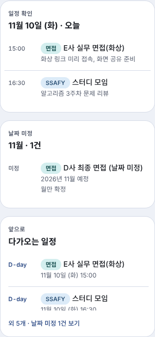<br>
      <sub><b>일정 확인 패널</b><br>날짜를 누르면 그날 일정과 날짜 미정 일정, 가까운 일정이 옆에 모입니다.</sub>
    </td>
    <td align="center" valign="top" width="50%">
      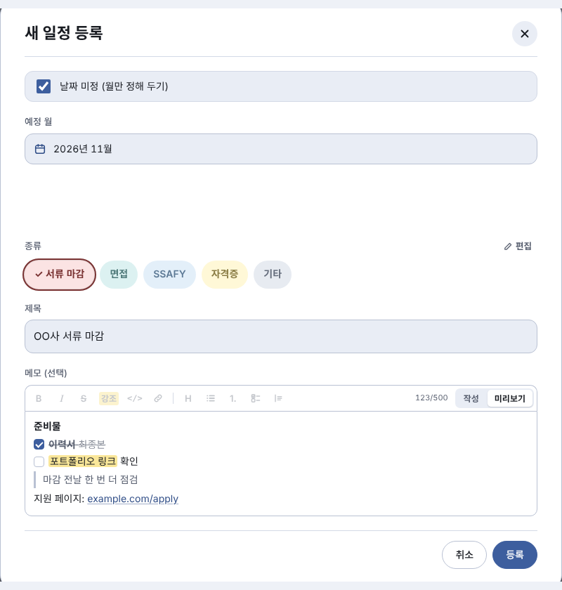<br>
      <sub><b>날짜 미정 일정</b><br>"11월 중 최종 면접"처럼 달만 정해진 일정도 등록할 수 있습니다.</sub>
    </td>
  </tr>
</table>

- 일정 종류(서류 마감, 면접, SSAFY, 자격증, 기타)를 직접 추가·삭제하고 8가지 색상 중에서 고를 수 있습니다.
- 서류 마감과 면접에는 **D-day**가 함께 표시됩니다.

### 2. 다가오는 일정

앞으로의 일정을 D-day와 함께 날짜순으로 모아 봅니다. 날짜가 정해지지 않은 일정은 아래에 따로 모입니다.

<p align="center">
  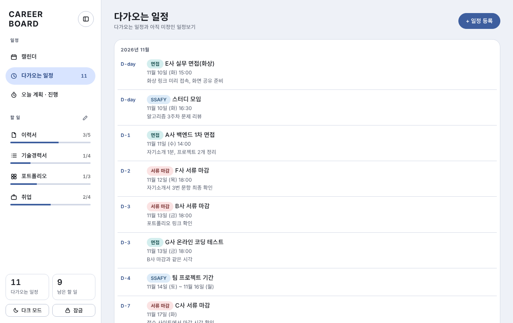
</p>

### 3. 메모 서식과 시간 선택

일정 메모와 할 일의 작업 내용·자세한 메모·진행 메모에서 **굵게, 강조, 링크, 체크 목록** 같은 간단한 서식(마크다운 방식)을 쓸 수 있고, 시간은 **직접 입력하거나 굴림 칸으로 1분 단위**까지 고릅니다.

<table align="center">
  <tr>
    <td align="center" valign="top">
      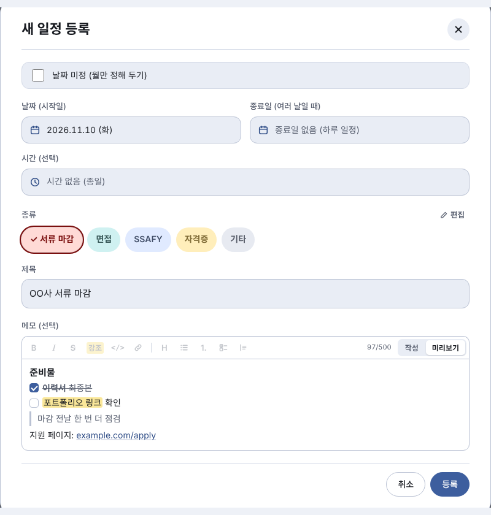<br>
      <sub><b>서식 메모</b> · 도구 막대와 미리보기</sub>
    </td>
    <td align="center" valign="top">
      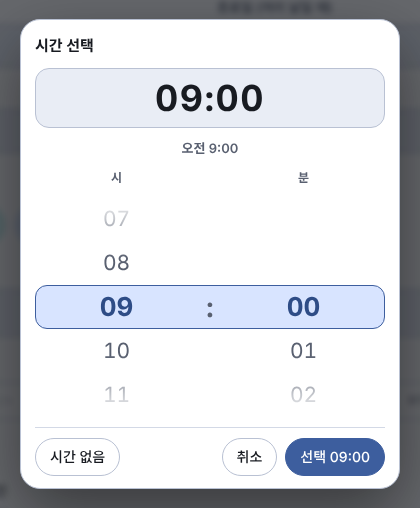<br>
      <sub><b>시간 선택</b> · 직접 입력 + 시·분 굴림 칸</sub>
    </td>
  </tr>
</table>

### 4. 문서별 할 일

이력서, 기술경력서, 포트폴리오, 취업 같은 **문서 탭**마다 해야 할 일을 따로 관리합니다. 우선순위(높음·중간·낮음)별로 묶어 보여 주고, 탭별 진행률을 한눈에 확인합니다.

<p align="center">
  
</p>

<p align="center">
  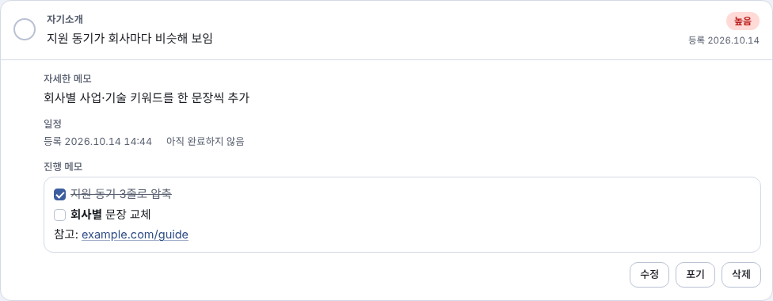
</p>
<p align="center"><sub><b>상세 · 진행 메모</b> — 항목을 누르면 자세한 메모와 일정, 서식이 적용된 진행 메모가 열립니다.</sub></p>

- 상태(전체·남은 것·완료)와 중요도로 거르고, 구분·작업 내용·메모를 검색합니다.
- 끝내지 않고 접은 항목은 사유를 남기고 "포기함"으로 옮깁니다. 포기한 항목은 진행률 계산에서 빠지고, 언제든 되살릴 수 있습니다.
- 문서 탭 이름 변경, 숨기기, 순서 변경이 가능합니다.

### 5. 오늘 계획 · 진행

하루를 세로 시간표로 보고 시간대별로 **계획**을 만듭니다. 계획마다 **집중 기록**을 남기면 실제로 집중한 시간(쉰 시간 제외)이 막대로 표시되고, 오른쪽 카드에 오늘 달성도가 쌓입니다.

<p align="center">
  
</p>

<table align="center">
  <tr>
    <td align="center" valign="top">
      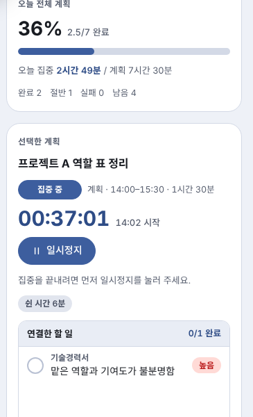<br>
      <sub><b>선택한 계획</b><br>타이머, 쉰 시간, 연결한 할 일</sub>
    </td>
    <td align="center" valign="top">
      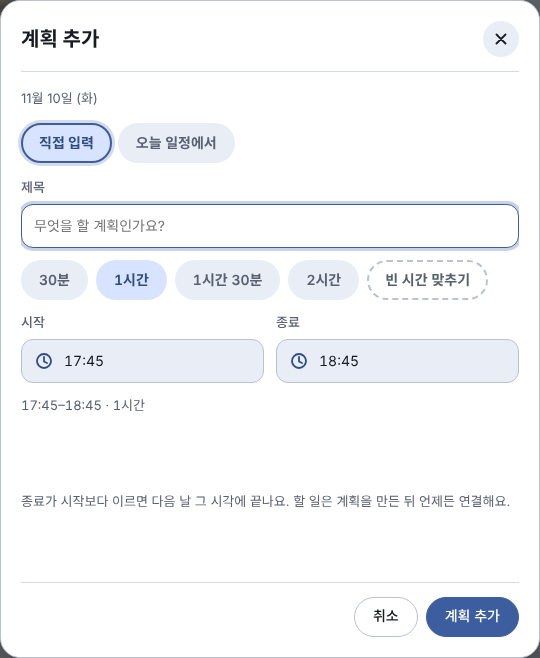<br>
      <sub><b>계획 추가</b><br>직접 입력하거나 오늘 일정에서 가져오기</sub>
    </td>
    <td align="center" valign="top">
      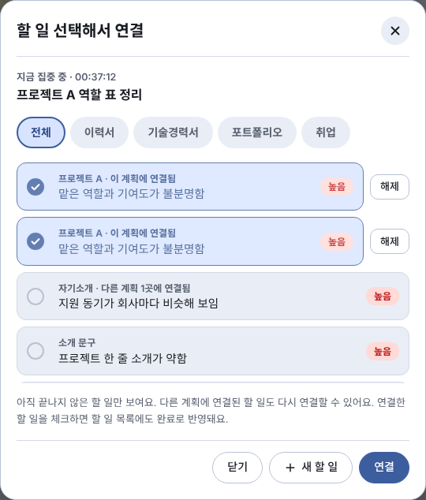<br>
      <sub><b>할 일 연결</b><br>계획에 문서별 할 일을 묶기</sub>
    </td>
  </tr>
</table>

- 계획 상태는 **대기 · 집중 중 · 완료 · 절반 · 실패**입니다. 절반은 달성도에 0.5로 계산합니다.
- 시간이 정해진 일정은 점선 계획으로 자동 생성됩니다.
- 계획끼리, 또는 일정과 시간이 겹치면 상단 팝업으로 경고합니다.
- 계획에 연결한 할 일을 체크하면 문서별 할 일에도 완료로 반영됩니다.

### 6. 집중 중 표시줄

집중 중인 계획이 있으면 **어느 화면에서든** 작은 표시줄이 따라다녀서, 다른 화면을 보면서도 타이머를 확인하고 일시정지·이어서·종료를 할 수 있습니다. 새로고침해도 저장된 집중 기록으로 다시 나타납니다.

<p align="center">
  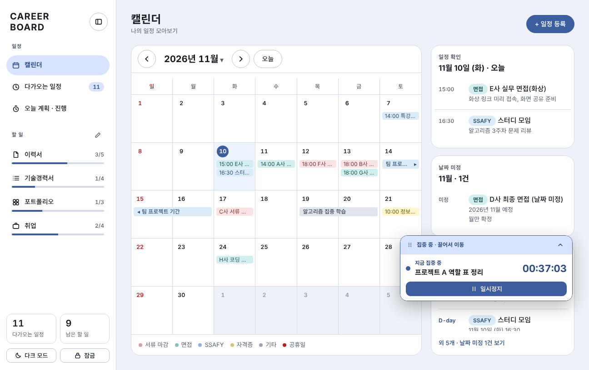
</p>

- 윗줄을 끌어서(또는 방향키로) 원하는 곳에 옮기고, 두 번 누르면 원래 자리로 돌아갑니다.
- 한 줄로 접을 수 있고, 팝업이나 사이드바가 열려 있을 때는 숨습니다.

### 7. 모바일 · 다크 모드 · 화면 잠금

한 벌의 코드로 데스크톱(사이드바 + 본문)과 모바일(상단 바 + 서랍 메뉴 + 등록 버튼)에 맞춰 바뀌고, 라이트/다크 모드를 지원합니다.

<table align="center">
  <tr>
    <td align="center"></td>
    <td align="center"></td>
    <td align="center">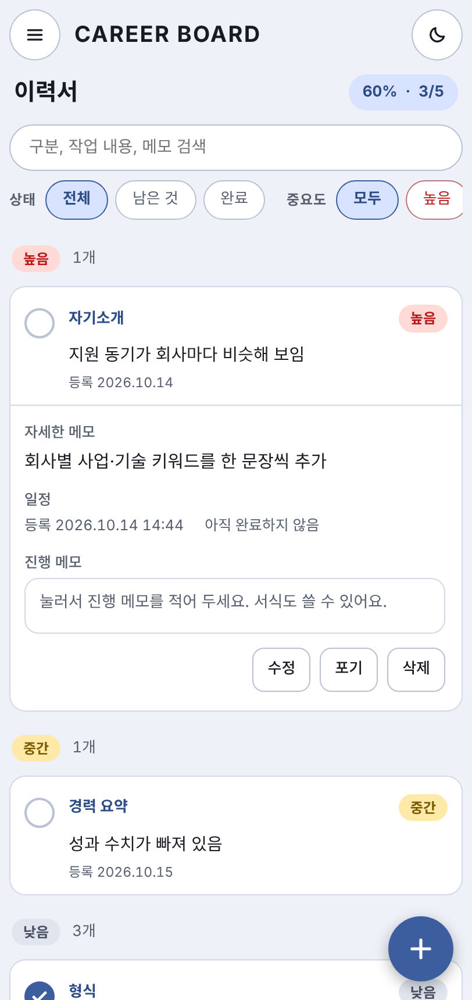</td>
    <td align="center"></td>
  </tr>
  <tr>
    <td align="center"><sub>캘린더</sub></td>
    <td align="center"><sub>오늘 계획</sub></td>
    <td align="center"><sub>할 일</sub></td>
    <td align="center"><sub>다크 모드</sub></td>
  </tr>
</table>

<table align="center">
  <tr>
    <td align="center"></td>
    <td align="center"></td>
  </tr>
  <tr>
    <td align="center"><sub>오늘 계획 · 다크 모드</sub></td>
    <td align="center"><sub>문서별 할 일 · 다크 모드</sub></td>
  </tr>
</table>

- 선택 사항으로 화면 잠금 비밀번호를 걸 수 있습니다. 비밀번호는 PBKDF2(SHA-256, 20만 회 반복)로 해시해서 브라우저에 저장합니다.
- 모바일에서는 입력 칸을 눌러도 화면이 확대되지 않도록 입력 글자를 16px로 하고, 화면 글자는 드래그로 선택되지 않게 했습니다(입력 칸은 선택 가능).

---

## 사용 방법

처음 쓰는 사람이 순서대로 따라 할 수 있게 정리한 사용자 설명서입니다.

**차례**
[0. 시작하기](#0-시작하기) · [1. 일정 등록하고 관리하기](#1-일정-등록하고-관리하기) · [2. 다가오는 일정 보기](#2-다가오는-일정-보기) · [3. 문서별 할 일 정리하기](#3-문서별-할-일-정리하기) · [4. 오늘 계획 세우고 집중 기록 남기기](#4-오늘-계획-세우고-집중-기록-남기기) · [5. 메모 서식 쓰기](#5-메모-서식-쓰기) · [6. 화면 설정](#6-화면-설정) · [7. 모바일에서 쓰기](#7-모바일에서-쓰기) · [8. 자주 묻는 질문](#8-자주-묻는-질문)

### 0. 시작하기

**열기** — 저장소를 받아 `index.html`을 브라우저로 열면 바로 시작됩니다([실행 방법](#실행-방법)). 처음 열면 가상의 샘플 일정·할 일·오늘 계획이 들어 있어서 화면이 어떻게 동작하는지 바로 눌러 볼 수 있습니다.

**화면 구성** — 왼쪽 사이드바에서 화면을 고르고, 오른쪽 본문에서 작업합니다.

| 사이드바 메뉴 | 하는 일 |
| --- | --- |
| 캘린더 | 월간 일정 보기, 일정 등록·수정·삭제 |
| 다가오는 일정 | D-day 순 일정 목록 (옆의 숫자는 다가오는 일정 수) |
| 오늘 계획 · 진행 | 하루 시간표, 계획 세우기, 집중 기록 |
| 할 일 › 이력서 · 기술경력서 · 포트폴리오 · 취업 | 문서별 할 일 (옆의 숫자는 완료/전체) |
| 다크 모드 · 잠금 | 화면 테마, 화면 잠금 비밀번호 |

> 입력한 데이터는 **사용 중인 브라우저에만** 저장되고 서버로 전송되지 않습니다. 브라우저 데이터를 지우면 함께 사라지니 중요한 내용은 따로 보관하세요.

**추천 사용 흐름**

1. 캘린더에 서류 마감·면접·시험 **일정을 등록**합니다.
2. 문서 탭에 **고칠 점**(할 일)을 적고 우선순위를 정합니다.
3. 아침에 "오늘 계획 · 진행"에서 **오늘 계획**을 세우고 할 일을 연결합니다.
4. 계획대로 **집중 시작 → 일시정지 → 종료**로 시간을 기록합니다.
5. 저녁에 달성도를 보고, 다음 날 어제 화면으로 실패·절반 계획을 돌아봅니다.

---

### 1. 일정 등록하고 관리하기

<p align="center">
  
</p>

**캘린더 보는 법**
- 위쪽 `‹` `›` 로 달을 넘기고, **오늘** 버튼으로 오늘이 있는 달로 돌아옵니다. 달 이름을 누르면 다른 달로 바로 이동할 수 있습니다.
- 일정 종류마다 부드러운 파스텔 톤의 색이 다릅니다(서류 마감 · 면접 · SSAFY · 자격증 · 기타). 여러 날 일정은 막대로 이어 보이고, 빨간 날짜는 공휴일입니다.
- 날짜를 누르면 오른쪽(모바일은 아래) 패널에 그날 일정이 나옵니다. 일정을 누르면 내용을 보고 고칠 수 있습니다.

**일정 등록하기**

1. 등록할 날짜를 누른 뒤 오른쪽 위 **+ 일정 등록**을 누릅니다(모바일은 오른쪽 아래 `+` 버튼).
2. **날짜**(시작일)를 고릅니다. 여러 날이면 **종료일**도 고릅니다.
3. **시간**을 고릅니다. 시간이 없으면 "시간 없음 (종일)"로 둡니다. 시간 선택 방법은 아래를 참고하세요.
4. **종류**를 고르고 **제목**을 적습니다. 제목은 한눈에 알아볼 수 있게 짧게 쓰는 것이 좋습니다.
5. 필요하면 **메모**에 장소, 준비물, 링크 등을 적습니다([메모 서식](#5-메모-서식-쓰기) 사용 가능).
6. **등록**을 누릅니다.

<table align="center">
  <tr>
    <td align="center" valign="top">
      <br>
      <sub>일정 등록 창</sub>
    </td>
    <td align="center" valign="top">
      <br>
      <sub>"날짜 미정"을 켜면 달만 고릅니다</sub>
    </td>
  </tr>
</table>

> 시간을 적은 일정은 그날 "오늘 계획 · 진행"에 **점선 계획**으로 자동으로 올라옵니다.

**시간 선택하기** — 시간 칸을 누르면 시간 선택 창이 열립니다.

<p align="center">
  
</p>

- 위쪽 큰 칸에 숫자를 직접 입력합니다(예: `0930` → 09:30).
- 또는 아래의 **시 · 분 굴림 칸**을 마우스 휠이나 손가락으로 굴리거나, 숫자를 눌러 고릅니다. 분은 1분 단위입니다.
- **선택**으로 확정하고, **시간 없음**으로 비우거나 **취소**로 닫습니다.

**날짜가 아직 정해지지 않았다면** — 등록 창 맨 위 **날짜 미정 (월만 정해 두기)** 를 체크하고 달만 고릅니다. 날짜 미정 일정은 캘린더 옆 패널의 "날짜 미정"과 다가오는 일정 아래쪽에 모이며, 날짜가 정해지면 일정을 열어 날짜를 넣으면 됩니다.

**일정 수정·삭제** — 일정을 눌러 창을 열고 내용을 고친 뒤 **저장**하거나, 왼쪽 아래 **삭제**를 누릅니다.

**일정 종류 바꾸기**

<p align="center">
  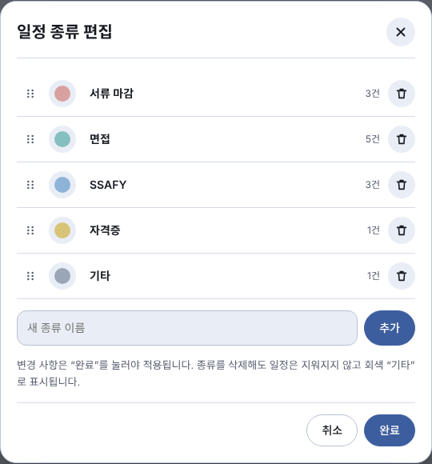
</p>

1. 일정 등록 창의 종류 오른쪽 **편집**을 누릅니다.
2. 이름 칸을 눌러 이름을 고치고, 색 동그라미를 눌러 색을 바꾸고(8가지), 손잡이를 끌어 순서를 바꿉니다.
3. 아래 입력 칸에 이름을 적고 **추가**하면 새 종류가 생깁니다. 휴지통으로 삭제할 수 있습니다.
4. **완료**를 눌러야 변경이 적용됩니다.

> 종류를 삭제해도 그 종류의 일정은 지워지지 않고 "기타"로 표시됩니다.

---

### 2. 다가오는 일정 보기

사이드바의 **다가오는 일정**에서 앞으로의 일정을 가까운 순서로 봅니다.

<p align="center">
  
</p>

- 왼쪽의 **D-day**(오늘은 `D-day`, 내일은 `D-1`)로 남은 날을 확인합니다. 서류 마감과 면접에는 항상 표시됩니다.
- 일정을 누르면 캘린더에서와 같은 창이 열려 고칠 수 있습니다.
- 날짜 미정 일정은 목록 아래 "날짜 미정"에 따로 모입니다.

---

### 3. 문서별 할 일 정리하기

사이드바의 **이력서 · 기술경력서 · 포트폴리오 · 취업**을 누르면 그 문서의 할 일 화면이 열립니다.

<p align="center">
  
</p>

**화면 보는 법**
- 맨 위 카드에 진행률(%)과 우선순위별 완료 수가 나옵니다.
- 항목은 **높음 → 중간 → 낮음** 순으로 묶여 있습니다. 완료한 항목은 취소선으로 표시됩니다.
- 상태(전체·남은 것·완료)와 중요도(모두·높음·중간·낮음) 버튼으로 거르고, 검색 칸에서 구분·작업 내용·메모를 찾습니다.

**할 일 추가하기**

1. 오른쪽 위 **+ 항목 추가**를 누릅니다.
2. **구분**(예: 자기소개, 경력 요약)과 **우선순위**를 고릅니다. 마감이 가까운 항목은 **높음**으로 올리세요.
3. **작업 내용**에 해야 할 일을, **자세한 메모**에 진행 방법이나 참고 사항(선택)을 적습니다. 두 칸 모두 [메모 서식](#5-메모-서식-쓰기)을 쓸 수 있습니다.
4. **저장**을 누릅니다.

<p align="center">
  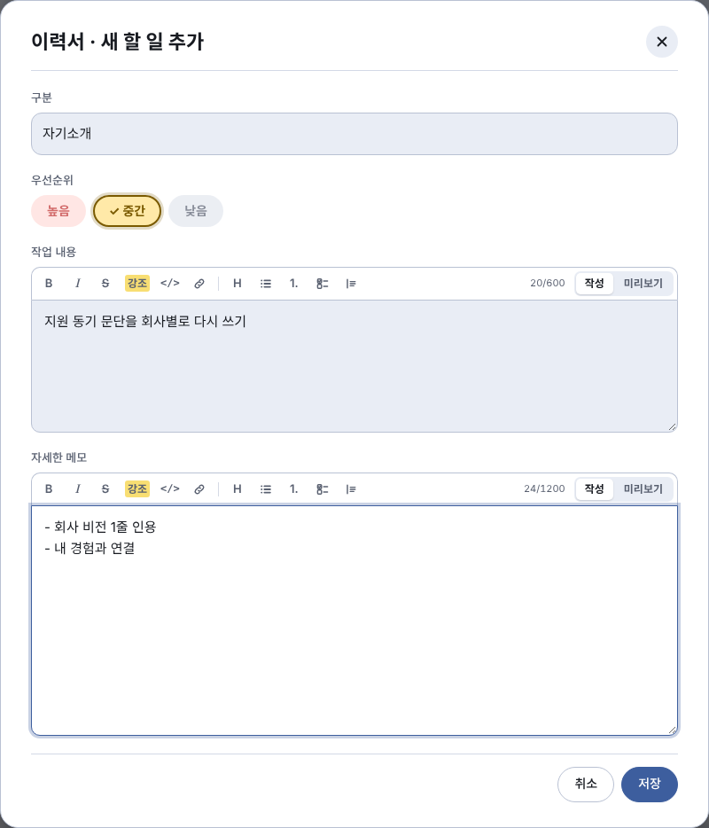
</p>

**완료 처리** — 항목 왼쪽 동그라미를 누르면 완료, 다시 누르면 완료 취소입니다. 완료하면 진행률이 올라갑니다.

**상세 보기와 진행 메모** — 항목을 누르면 아래로 펼쳐집니다.

<p align="center">
  
</p>

- **자세한 메모**: 등록할 때 적은 참고 사항입니다.
- **일정**: 등록 시각과 완료 시각이 기록됩니다.
- **진행 메모**: 일하면서 수시로 적는 칸입니다. 평소에는 서식이 적용된 글로 보이고, **눌러서** 고친 뒤 바깥을 누르면 저장됩니다.
- 아래 **수정 · 포기 · 삭제** 버튼으로 항목을 관리합니다.

**포기와 되살리기** — 끝내지 않고 접기로 한 항목은 삭제하지 말고 **포기**하세요.

<p align="center">
  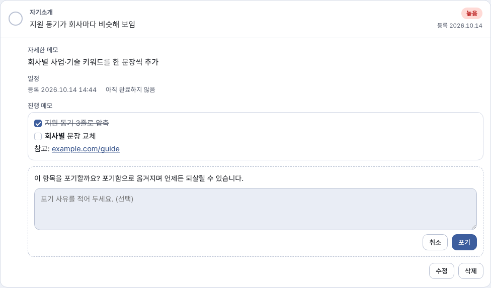
</p>

1. 항목을 펼치고 **포기**를 누릅니다.
2. 사유를 적고(선택) 다시 **포기**를 누릅니다.
3. 항목은 목록 아래 접이식 **포기함**으로 옮겨지고 진행률 계산에서 빠집니다. 사유는 메모에 `[포기 사유] …`로 남습니다.
4. 포기함에서 항목을 열어 되살릴 수 있습니다.

**문서 탭 관리** — 사이드바 "할 일" 옆 연필(모바일은 메뉴 속 **카테고리 편집**)을 누릅니다.

<p align="center">
  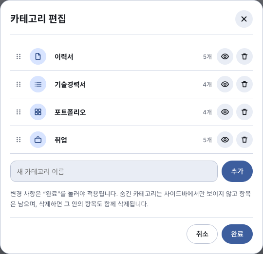
</p>

- 손잡이를 끌어 순서를 바꾸고, 아이콘 버튼으로 아이콘을, 이름 칸에서 이름을 바꿉니다. 눈 아이콘으로 숨기거나 보이게 하고, 휴지통으로 삭제합니다(삭제는 완료 전까지 **되돌리기** 가능).
- 아래 입력 칸에서 새 탭(예: 자격증)을 추가합니다.
- **완료**를 눌러야 적용됩니다. 숨긴 탭은 사이드바에서만 보이지 않고 항목은 남아 있으며, **삭제하면 그 안의 항목도 함께 삭제**됩니다.

---

### 4. 오늘 계획 세우고 집중 기록 남기기

사이드바의 **오늘 계획 · 진행**에서 하루를 시간표로 봅니다. 왼쪽이 시간표, 오른쪽이 오늘 달성도와 선택한 계획입니다.

<p align="center">
  
</p>

**시간표 보는 법**
- 파란 칸이 계획입니다. 계획에 집중 기록이 생기면 그 계획 칸이 **세션마다 다른 파스텔 색**으로 바뀌고, 칸 오른쪽의 세로 막대가 **실제 집중한 구간**입니다. 막대는 칸과 같은 계열의 색이라 어느 계획을 얼마나 집중했는지 색으로 짝을 맞춰 볼 수 있습니다(쉰 구간에서 끊기고, 계획 시간을 넘긴 구간도 같은 색입니다).
- 세션 색은 그날이 아니라 집중을 시작한 순서대로 8가지(분홍빛 빨강, 연두, 하늘, 살구, 노랑, 연보라, 진분홍, 회청색)를 돌려 씁니다. 같은 계획은 자정을 넘어 이어져도 같은 색입니다. 라이트·다크 테마에 맞는 색을 따로 씁니다.
- 집중 기록이 있는 계획을 선택하면 파란 테두리 대신 그 계획의 세션 색 테두리가 보입니다.
- 빨간 가로선은 현재 시각입니다.
- 점선 칸은 시간이 정해진 **일정에서 자동으로 만들어진 계획**입니다. 시간만 고칠 수 있고, 시간표에서 빼면 다시 만들지 않습니다.
- 칸 안의 아이콘: 완료 ✓, 절반 △, 실패 ✕, 겹침 경고 ⚠. 대기와 집중 중은 아이콘이 없습니다.
- 위쪽 `‹` `›`로 어제·내일로 이동합니다.

**① 계획 만들기**

<p align="center">
  
</p>

1. 오른쪽 위 **계획 추가**를 누릅니다.
2. **직접 입력**: 제목을 적고, 시간 버튼(30분·1시간·1시간 30분·2시간)이나 **빈 시간 맞추기**로 길이를 정하거나 시작·종료를 직접 고릅니다. **오늘 일정에서**: 오늘 일정 중 하나를 골라 계획으로 만듭니다.
3. **계획 추가**를 누릅니다. 종료가 시작보다 이르면 다음 날 시각으로 계산합니다(최대 다음 날 24:00).

시간을 겹치게 잡으면 화면 위에 경고가 뜹니다.

<p align="center">
  
</p>

**시간 조정**으로 고치거나, 그대로 둘 거면 **그대로 두기**를 누릅니다.

**② 계획 옮기고 고치기**
- **PC**: 계획 칸을 끌어 시간을 옮기고(15분 단위), 아래 끝을 끌어 길이를 바꿉니다.
- **모바일**: 계획을 꾹 눌러 시작 시간을 옮깁니다. 길이는 수정 창에서 고칩니다.
- 이름·시간 수정과 삭제는 계획을 **더블클릭**(모바일은 선택 시트의 **수정**)해서 여는 창에서 합니다. 삭제는 한 번 더 확인합니다.

**③ 할 일 연결하기** — 계획을 누르면 오른쪽 카드에 "연결한 할 일"이 나옵니다.

<p align="center">
  
</p>

1. **할 일 선택해서 연결**을 누르고, 탭 버튼으로 문서를 거르면서 연결할 항목을 고릅니다(여러 개 가능).
2. **연결**을 누릅니다. 이미 연결된 항목은 **해제**할 수 있습니다.
3. 목록에 원하는 항목이 없으면 **새 할 일**로 만들어서 바로 연결합니다.
4. 연결한 할 일을 오른쪽 카드에서 체크하면 문서별 할 일에도 완료로 반영됩니다.

**④ 집중 기록 남기기** — 계획을 선택하고 카드의 버튼을 누릅니다.

<p align="center">
  
</p>

| 버튼 | 동작 |
| --- | --- |
| **집중 시작** | 타이머가 시작되고 상태가 "집중 중"이 됩니다 |
| **일시정지** | 쉬는 시간으로 기록합니다(쉰 시간은 집중 시간에서 빠짐. 1분 미만 휴식은 집중에 포함) |
| **이어서 집중** | 쉬다가 다시 집중합니다 |
| **집중 종료** | 일시정지한 뒤 누르면 기록을 마치고 계획이 **완료**가 됩니다 |

- 계획 하나에 집중 기록은 1개만 남습니다. 집중 중인 계획은 동시에 1개입니다.
- 계획 시간을 넘기면 상단 알림으로 알려 줍니다.
- 집중은 그날(자정을 넘는 계획은 다음 날)에만 시작할 수 있습니다.

**⑤ 결과 고치기** — 끝낸 계획은 상태 칩으로 **완료 ↔ 절반**을 바꿀 수 있습니다. 절반은 달성도에 0.5점으로 계산되고, 같은 날 안에서는 **이어서 집중**으로 같은 기록을 다시 열 수 있습니다. 실제 집중 시간과 기록이 다르면 **집중 시간 수정**에서 시작·종료, 쉰 구간을 직접 고치거나 기록을 지웁니다.

<p align="center">
  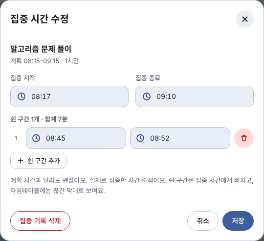
</p>

**⑥ 돌아보기** — 오른쪽 위 카드에서 **오늘 전체 달성도**(완료 1점, 절반 0.5점)와 집중 시간, 완료·절반·실패·남음 수를 봅니다. 위쪽 `‹`로 어제로 가면 집중하지 못한 계획이 **실패**로 보입니다. 지난 날짜는 보기만 할 수 있습니다.

<p align="center">
  
</p>

**집중 중 표시줄** — 집중 중인 계획이 있으면 다른 화면(캘린더, 할 일 등)에서도 화면 위에 표시줄이 떠서 타이머를 확인하고 **일시정지 · 이어서 · 종료**를 할 수 있습니다.

<p align="center">
  
</p>

- **옮기기**: 윗줄(`⋮⋮ 집중 중 · 끌어서 이동`)을 끌거나, 윗줄에 초점을 두고 방향키를 누릅니다. 두 번 누르면 기본 위치로 돌아갑니다.
- **접기**: 오른쪽 위 화살표로 한 줄 모드로 접고 펼칩니다.
- 팝업이나 사이드바가 열려 있을 때, 그리고 계획 화면에서 그 계획의 타이머가 이미 보일 때는 자동으로 숨습니다.
- 위치와 접힘 상태는 이 브라우저에 기억됩니다.

---

### 5. 메모 서식 쓰기

일정 메모, 할 일의 작업 내용·자세한 메모·진행 메모에서 마크다운 방식의 간단한 서식을 쓸 수 있습니다. 저장되는 것은 서식 기호가 들어 있는 일반 글자이고, 보여 줄 때만 꾸밉니다. 예전에 적어 둔 메모도 그대로 보입니다.

<p align="center">
  
</p>

**입력 방법** — 입력 칸 위 **도구 막대**의 버튼을 누르거나, 아래 기호를 직접 입력합니다. 오른쪽 **작성 / 미리보기**로 결과를 확인합니다.

| 서식 | 입력 |
| --- | --- |
| 굵게 · 기울임 · 취소선 · 강조 | `**굵게**` · `*기울임*` · `~~취소선~~` · `==강조==` |
| 코드 | `` `코드` `` |
| 링크 | `[글자](https://주소)` 또는 주소를 그대로 입력 |
| 목록 · 번호 · 체크 | `- 항목` · `1. 항목` · `- [ ] 할 일` / `- [x] 끝낸 일` |
| 인용 · 제목 · 구분선 | `> 인용` · `# 제목` (`#`~`###`) · `---` |

- 목록 들여쓰기는 3단계까지 반영합니다. 표, 이미지, 여러 줄 코드 블록은 지원하지 않습니다.
- 글자는 HTML로 해석하지 않고, 링크는 `http`/`https` 주소만 열립니다.
- 길이 제한: 일정 메모 500자, 작업 내용 600자, 자세한 메모 1200자, 진행 메모 2000자.

---

### 6. 화면 설정

<table align="center">
  <tr>
    <td align="center" valign="top">
      <br>
      <sub>다크 모드</sub>
    </td>
    <td align="center" valign="top">
      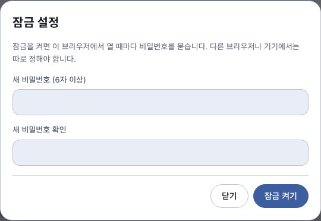<br>
      <sub>잠금 설정</sub>
    </td>
  </tr>
</table>

- **다크 모드**: 사이드바 아래(모바일은 상단 바·메뉴)의 **다크 모드** 버튼으로 라이트/다크를 바꿉니다. 선택은 기억됩니다.
- **사이드바 접기**: 사이드바 위쪽 버튼으로 접고 펼칩니다.
- **화면 잠금**: **잠금**(모바일은 메뉴의 **잠금 설정**)에서 6자 이상 비밀번호를 정하면, 이 브라우저에서 열 때마다 비밀번호를 묻습니다. 설정 창에서 **지금 잠그기**, **잠금 끄기**도 할 수 있습니다.
  - 비밀번호를 잊었다면 잠금 화면의 **비밀번호를 잊었어요 → 잠금 지우기**로 잠금만 지우고 새로 정할 수 있습니다. 일정과 할 일 데이터는 지워지지 않습니다.
  - 잠금은 화면을 가리는 용도입니다. 데이터를 암호화하지는 않습니다.

---

### 7. 모바일에서 쓰기

폰에서는 사이드바 대신 **상단 바의 메뉴 버튼**으로 서랍 메뉴를 열고, 일정은 **오른쪽 아래 `+` 버튼**으로 등록합니다.

<table align="center">
  <tr>
    <td align="center">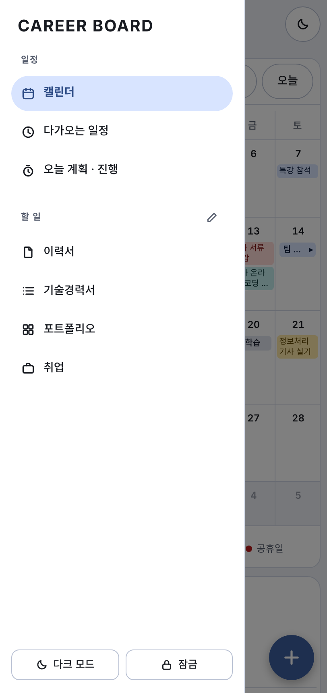</td>
    <td align="center">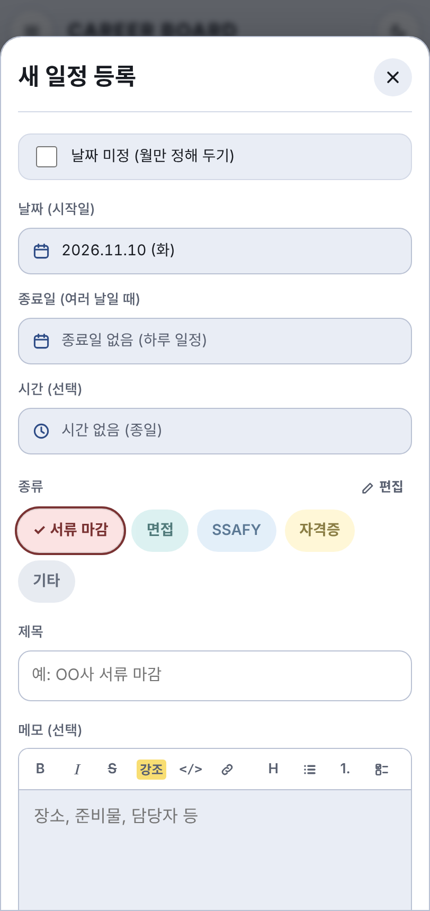</td>
    <td align="center"></td>
    <td align="center"></td>
  </tr>
  <tr>
    <td align="center"><sub>서랍 메뉴</sub></td>
    <td align="center"><sub>일정 등록</sub></td>
    <td align="center"><sub>할 일</sub></td>
    <td align="center"><sub>오늘 계획</sub></td>
  </tr>
</table>

- 날짜를 누르면 일정 패널이 달력 **아래**에 나옵니다.
- 오늘 계획은 계획을 **꾹 눌러** 시작 시간을 옮기고, 선택한 계획의 집중 버튼은 화면 아래 바에 나옵니다. 길이 조절은 수정 창에서 합니다.
- 집중 중 표시줄은 기본으로 화면 오른쪽 아래에 한 줄 모드로 뜹니다. 끌어서 옮기거나 펼칠 수 있습니다.
- 입력 칸을 눌러도 화면이 확대되지 않고, 화면 글자는 드래그로 선택되지 않습니다(입력 칸 제외).

---

### 8. 자주 묻는 질문

**Q. 데이터가 어디에 저장되나요?**
사용 중인 브라우저의 localStorage에만 저장됩니다. 서버로 전송되지 않으며, 브라우저 데이터를 지우면 함께 사라집니다. 기기 간 동기화는 되지 않습니다.

**Q. 샘플 데이터를 지우고 새로 시작하고 싶어요.**
샘플은 처음 열 때 한 번만 들어갑니다. 항목을 직접 삭제하거나, 브라우저의 사이트 데이터(localStorage)를 지운 뒤 다시 열면 새 샘플이 들어옵니다. 실제로 쓸 때는 샘플을 삭제하고 시작하세요.

**Q. 집중 종료 버튼이 보이지 않아요.**
집중 중에는 먼저 **일시정지**를 누른 뒤에 **집중 종료**가 나타납니다.

**Q. 어제 계획에서 집중을 시작할 수 없어요.**
지난 날짜의 계획은 보기만 할 수 있습니다. 집중은 그날(자정을 넘는 계획은 다음 날)에만 시작할 수 있습니다.

**Q. 일정에서 만든 계획이 삭제되지 않아요.**
집중 기록이 있는 일정 계획은 삭제·제외할 수 없습니다. **집중 시간 수정**에서 기록을 지우면 제외할 수 있습니다.

**Q. 메모에 쓴 서식이 적용되지 않아요.**
서식은 한 줄 단위로 해석됩니다. 여러 줄에 걸친 굵게·코드는 적용되지 않으니 줄마다 따로 적으세요. 작성/미리보기 버튼으로 결과를 확인할 수 있습니다.

---

## 실행 방법

설치할 것이 없습니다. 저장소를 받아서 `index.html`을 브라우저로 열면 됩니다.

```bash
git clone https://github.com/min-0o0/Career-Board.git
cd Career-Board
# index.html을 브라우저로 열거나, 간단한 서버를 띄워서 확인합니다.
python3 -m http.server 8000   # http://localhost:8000
```

처음 열면 가상의 샘플 일정, 할 일, 오늘 계획이 들어 있습니다. 입력한 데이터는 사용 중인 브라우저의 localStorage에만 저장되고 서버로 전송되지 않습니다.
(브라우저 데이터를 지우면 함께 사라집니다.)

## 구조

```
.
├── index.html       # 화면 구조(마크업)
├── style.css        # 스타일, 라이트/다크 테마 변수
├── app.js           # 화면 로직 (캘린더, 할 일, 오늘 계획·진행, 서식 메모, 잠금, 일정 종류/탭 편집)
├── local-db.js      # localStorage 기반 저장소 어댑터 + 샘플 데이터
├── docs/screenshots # README 이미지 (가상 샘플 데이터 화면)
└── docs/db          # DB 설계 문서 (명세서 PPT·생성 스크립트, ERD, 참고용 SQL)
```

## DB 설계 문서

- 명세서: [docs/db/career-board-db-spec.pptx](docs/db/career-board-db-spec.pptx) — 컬렉션·컬럼·관계·역할, ERD, 수정 내역
- 참고용 SQL: [schema.sql](docs/db/schema.sql) (SQLite 문법 DDL), [sample-data.sql](docs/db/sample-data.sql) (가상 샘플). 실제 앱은 SQL을 쓰지 않고 localStorage(JSON)에 저장하며, 같은 구조를 관계형으로 옮긴 설계 문서입니다.
- 명세서 생성 스크립트: [build.js](docs/db/build.js) (`cd docs/db && node build.js`)
- ERD: 
- 컬렉션 구조를 바꾸면 명세서의 수정 내역 페이지에 한 줄 추가합니다.

## 기술적으로 고민한 점

- **저장소 어댑터 분리**: 이 앱은 원래 Claude 아티팩트의 저장소(`window.claude.use("db")`) 위에서 동작하도록 만들었습니다.
  `local-db.js`가 같은 인터페이스(`collection().add / onSnapshot`, `doc().set / update / delete`)를 localStorage로 구현해서, `app.js`를 거의 고치지 않고 정적 호스팅에서도 같은 코드가 돌아갑니다.
- **날짜 미정 일정**: 일정 데이터에 `date`와 `month`를 따로 두어, 날짜가 확정된 일정과 월만 정해진 일정을 한 목록에서 정렬하고 표시합니다.
- **계산으로 구하는 상태**: 계획의 "실패"와 겹침은 저장하지 않고 화면에서 계산합니다. 집중 시간도 저장된 시작·종료·쉰 구간에서 매번 계산하므로, 기록을 고치면 막대와 통계가 함께 바뀝니다.
- **반응형 한 벌의 코드**: 데스크톱과 모바일의 내비게이션 구조가 다르지만 CSS 변수와 같은 컴포넌트를 공유해서 화면별로 코드를 나누지 않았습니다.
- **접근성**: 키보드 포커스 표시, `aria-label`, 순서 변경 시 키보드 조작을 지원하도록 마크업했습니다.
- **서식 메모를 안전하게 그리기**: 저장은 서식 기호가 든 일반 글자 그대로 두고, 보여 줄 때 정규식으로 해석해 DOM을 직접 만듭니다(`innerHTML`로 넣지 않으므로 메모에 HTML을 적어도 실행되지 않습니다). 링크는 `http`/`https`만 허용하고 `rel="noopener noreferrer"`를 붙입니다.

## 알려진 한계

- 화면 잠금은 같은 브라우저 안에서 화면을 가리는 용도입니다. 데이터를 암호화하지는 않으므로 민감한 정보는 입력하지 마세요.
- 데이터가 브라우저 localStorage에 있어서 기기 간 동기화는 되지 않습니다.
- 공휴일은 코드에 내장된 2025~2028년 목록을 사용하므로, 그 이후 연도는 직접 추가해야 합니다.
- 일정에는 종료 시각이 없어서, 일정에서 만든 계획과 일정의 겹침 계산은 길이를 60분으로 가정합니다.
- 지난 날짜의 계획은 보기만 할 수 있습니다. 집중은 그날(또는 자정을 넘는 계획의 다음 날)에만 시작할 수 있고, 절반 계획의 이어서 집중도 같은 날에만 가능합니다.
- 모바일에서는 계획의 길이를 끌어 바꿀 수 없습니다(시작 시간 이동과 수정 팝업은 가능). 자정을 넘는 계획은 끌어 옮길 수 없고 수정 팝업으로 고칩니다.
- 메모 서식은 한 줄 단위로 해석하므로 여러 줄에 걸친 굵게·코드 같은 표기는 적용되지 않습니다.
- "집중 중" 표시줄의 위치와 접힘 상태는 사용 중인 브라우저(localStorage)에만 저장되어 기기마다 따로입니다.
- 처음 열 때 한 번만 가상의 샘플 데이터가 들어가고, 이미 열어 본 브라우저에는 다시 들어가지 않습니다. 새 샘플을 보려면 브라우저의 사이트 데이터를 지운 뒤 다시 여세요.
- 오늘 화면의 샘플은 열어 본 시각 주변(12:00~19:00 사이)에 맞춰 배치됩니다. "실패" 상태는 지난 날짜에서만 계산되므로, 오늘이 아니라 어제 화면에서 확인하세요.

## 라이선스

[MIT License](LICENSE)
