# CAREER BOARD

취업 준비에 흩어져 있는 **일정**과 **문서별 할 일**을 한 화면에서 관리하는 개인용 보드입니다.
서류 마감, 면접, 시험 일정은 캘린더에서 보고, 이력서·기술경력서·포트폴리오 같은 문서마다 고칠 점을 우선순위와 함께 정리합니다.
하루 시간표에서 계획을 세우고 실제로 집중한 시간을 기록하는 "오늘 계획 · 진행" 화면도 있습니다.

프레임워크나 빌드 과정 없이 **HTML · CSS · 바닐라 JavaScript**만으로 만들었습니다.

<p align="center">
  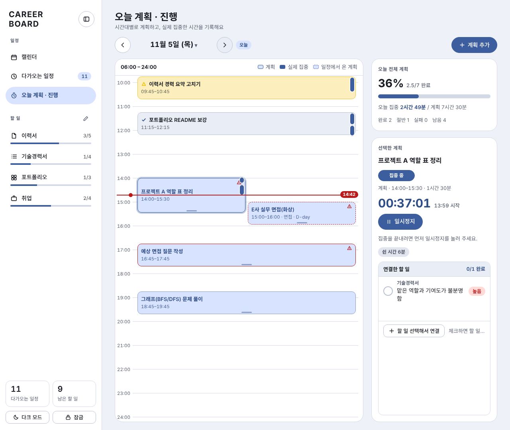
</p>
<p align="center"><sub>오늘 계획 · 진행 (데스크톱)</sub></p>

> 스크린샷의 일정, 할 일, 계획은 모두 가상의 샘플 데이터입니다. 모든 화면은 [사용 방법](#사용-방법)에서 볼 수 있습니다.

## 만든 이유

취업 준비를 하다 보면 마감일은 달력 앱에, 이력서 수정 사항은 메모장에, 포트폴리오 보완점은 또 다른 문서에 흩어집니다.
"이번 주에 뭘 먼저 해야 하지?"를 한 번에 볼 수 있는 화면이 필요해서 직접 만들었습니다.

## 주요 기능

**일정**
- 월간 캘린더에 일정을 한눈에 표시하고, 여러 날에 걸친 일정은 막대로 이어서 보여 줍니다.
- 날짜는 아직 모르고 달만 정해진 일정(예: "11월 중 최종 면접")도 등록할 수 있습니다.
- 다가오는 일정을 D-day와 함께 모아 보여 줍니다.
- 일정 종류(서류 마감, 면접, 자격증 등)를 직접 추가·삭제하고 8가지 색상 중에서 고를 수 있습니다.
- 공휴일이 캘린더에 함께 표시됩니다.
- 일정 메모에 간단한 서식(굵게, 링크, 목록 등)을 쓸 수 있습니다. 쓸 수 있는 서식은 [메모 서식](#메모-서식)에 정리했습니다.

**문서별 할 일**
- 이력서, 기술경력서, 포트폴리오, 취업 등 문서 탭마다 해야 할 일을 따로 관리합니다. 탭 이름 변경, 숨기기, 순서 변경이 가능합니다.
- 항목마다 구분, 작업 내용, 해결 방법, 메모를 적고 우선순위(높음/중간/낮음)를 정합니다.
- 작업 내용, 자세한 메모, 진행 메모에도 같은 서식을 쓸 수 있습니다. 입력 칸 위의 도구 막대로 넣거나 기호를 직접 입력하고, **미리보기**로 확인합니다. 진행 메모는 평소에는 서식이 적용된 글로 보이고, 눌러서 고치는 방식입니다.
- 끝내지 않고 아예 접은 항목은 "포기"로 표시합니다. 포기 항목은 목록 아래 접이식 "포기함"에 모이고(✕ 아이콘, 회색 취소선), 사유를 메모에 남길 수 있으며, 언제든 되살릴 수 있습니다. 진행률 계산에서는 빠집니다.
- 상태와 중요도로 거르고 검색할 수 있으며, 탭별 진행률을 표시합니다.

**오늘 계획 · 진행**
- 하루를 세로 시간표(기본 06:00~24:00, 더 이른 계획이 있으면 앞당겨 표시)로 보고 시간대별로 "계획"을 만듭니다. 데스크톱에서는 마우스로 끌어 옮기고(15분 단위) 아래 끝을 끌어 길이를 바꿉니다. 모바일에서는 계획을 꾹 눌러 시작 시간을 옮깁니다.
- 계획마다 집중 기록을 1개 남깁니다. 시작·일시정지·이어서·종료를 지원하고, 쉰 시간은 집중 시간에서 뺍니다(1분 미만 휴식은 기록하지 않고 집중으로 포함). 계획 시간을 넘기면 상단 알림으로 알려 줍니다.
- 상태는 대기 · 집중 중 · 완료 · 절반 · 실패입니다. 완료 칩을 눌러 절반으로 바꾸면 달성도에 0.5로 계산하고(절반 계획은 같은 날 안이면 [이어서 집중]으로 같은 집중 기록을 다시 열 수 있고, 종료~재개 사이는 쉰 시간으로 남습니다), 실패는 날짜가 지난 미착수 계획에서 계산합니다.
- 시간이 정해진 일정은 점선 계획으로 자동 생성됩니다(시간만 수정 가능). 시간표에서 빼면 다시 만들지 않습니다.
- 계획에 문서별 할 일을 연결하거나 새 할 일을 만들어 연결할 수 있고, 체크하면 할 일 목록에도 완료로 반영됩니다.
- 집중 중인 계획이 있으면 어느 화면에서든 "지금 집중 중" 표시줄이 떠서 타이머를 보고 일시정지·이어서·종료를 할 수 있습니다. 새로고침해도 저장된 집중 기록으로 다시 나타납니다. 윗줄을 끌어(또는 방향키로) 옮기고 두 번 누르면 원래 자리로 돌아가며, 한 줄로 접을 수 있습니다. 팝업이나 사이드바가 열려 있을 때, 그리고 계획 화면에서 그 계획의 타이머가 이미 보일 때는 숨깁니다.
- 계획 종료는 다음 날 24:00까지 잡을 수 있고(자정을 넘는 계획) 통계는 시작한 날에만 반영합니다. 계획끼리, 또는 일정과 시간이 겹치면 팝업으로 경고합니다.

**화면**
- 데스크톱은 사이드바 + 본문, 모바일은 상단 바 + 하단 탭 구성으로 화면 크기에 맞게 바뀝니다.
- 라이트/다크 모드를 지원하고, 사이드바는 접을 수 있습니다.
- 모바일에서는 입력 칸을 눌러도 화면이 확대되지 않도록 입력 글자를 16px로 하고, 화면 글자는 드래그로 선택되지 않게 했습니다(입력 칸은 선택 가능).
- 일정·할 일 수정 창을 넓혀 긴 메모도 편하게 적을 수 있고, 데스크톱 계획 화면은 오른쪽 카드(오늘 달성도·선택한 계획) 너비를 넓혔습니다.
- 시간 선택은 위쪽 칸에 직접 입력(예: `0930`)하거나 시·분 두 개의 굴림 칸으로 1분 단위까지 고릅니다. 시간을 비워 둘 수 있는 항목은 "시간 없음"으로 비웁니다.
- 선택 사항으로 화면 잠금 비밀번호를 걸 수 있습니다. 비밀번호는 PBKDF2(SHA-256, 20만 회 반복)로 해시해서 브라우저에 저장합니다.

## 사용 방법

### 기본 사용 흐름

1. **일정 등록** — 캘린더에서 **+ 일정 등록**으로 날짜·시간·제목·종류·메모를 적습니다. 여러 날이면 종료일을, 날짜를 모르면 달만 고릅니다. 시간을 적은 일정은 그날 "오늘 계획 · 진행"에 점선 계획으로 자동으로 올라옵니다.
2. **할 일 정리** — 사이드바에서 문서 탭(이력서, 기술경력서 등)을 열고 **+ 항목 추가**로 고칠 점을 적습니다. 우선순위를 정하고, 마감이 가까운 항목은 높음으로 올립니다.
3. **오늘 계획 세우기** — "오늘 계획 · 진행"에서 시간대별 계획을 만들고, 계획마다 문서별 할 일을 연결합니다(새 할 일을 만들어 바로 연결할 수도 있습니다).
4. **집중 기록 남기기** — 계획을 고르고 **집중 시작**을 누릅니다. 쉬려면 **일시정지**, 끝내려면 일시정지 후 **집중 종료**를 누릅니다. 끝낸 계획은 완료로 기록되고, 덜 끝냈다면 상태 칩을 눌러 **절반**으로 바꿉니다.
5. **돌아보기** — 연결한 할 일을 체크하면 문서별 할 일의 진행률에도 반영됩니다. 어제로 이동하면 집중하지 못한 계획이 **실패**로 보입니다.

### 캘린더

<p align="center">
  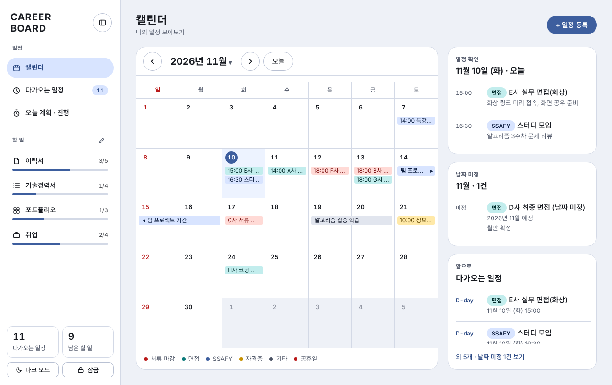
</p>
<p align="center"><sub>라이트 모드</sub></p>

<p align="center">
  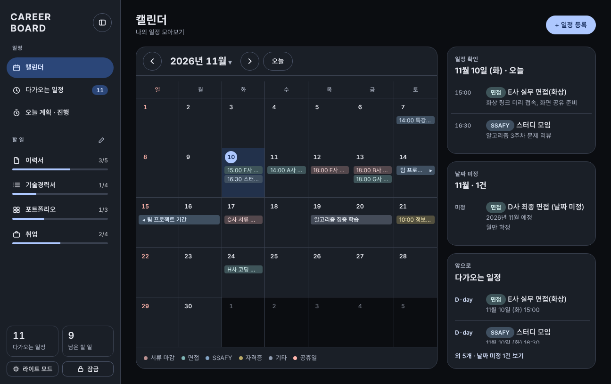
  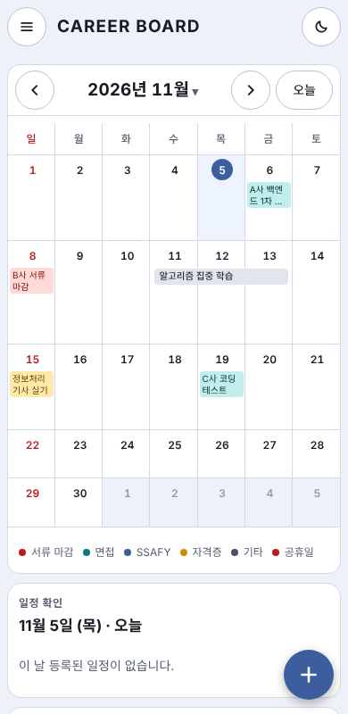
  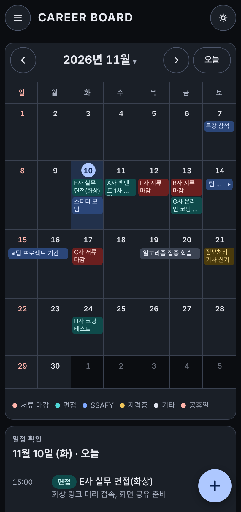
</p>
<p align="center"><sub>다크 모드 · 모바일 · 모바일 다크</sub></p>

- 일정 종류마다 색이 달라 한눈에 구분됩니다(서류 마감 · 면접 · SSAFY · 자격증 · 기타). 기간 일정은 막대로 이어 보여 줍니다.
- 날짜를 누르면 그날 일정이 옆(모바일은 아래)에 나옵니다. 날짜 미정 일정은 달별로 따로 모입니다.
- "다가오는 일정"에는 서류 마감과 면접의 D-day가 함께 표시됩니다.

### 문서별 할 일

<p align="center">
  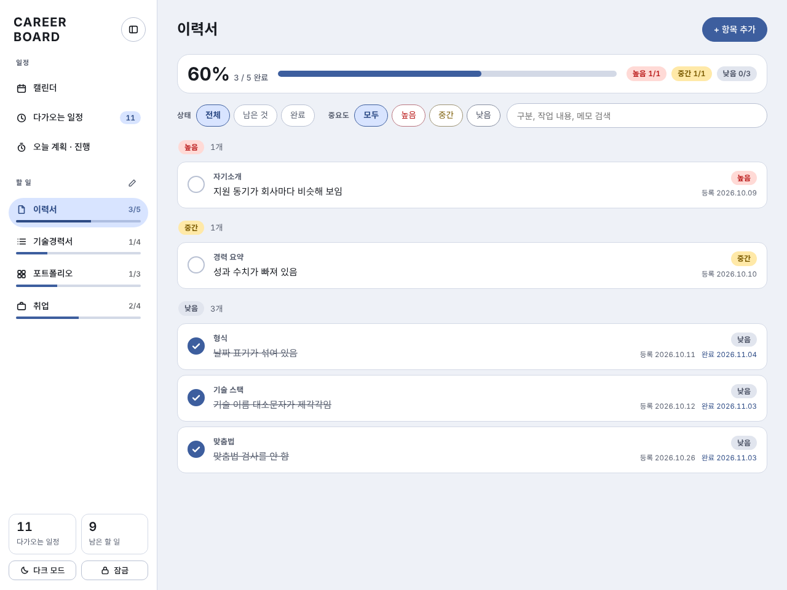
</p>
<p align="center"><sub>라이트 모드</sub></p>

<p align="center">
  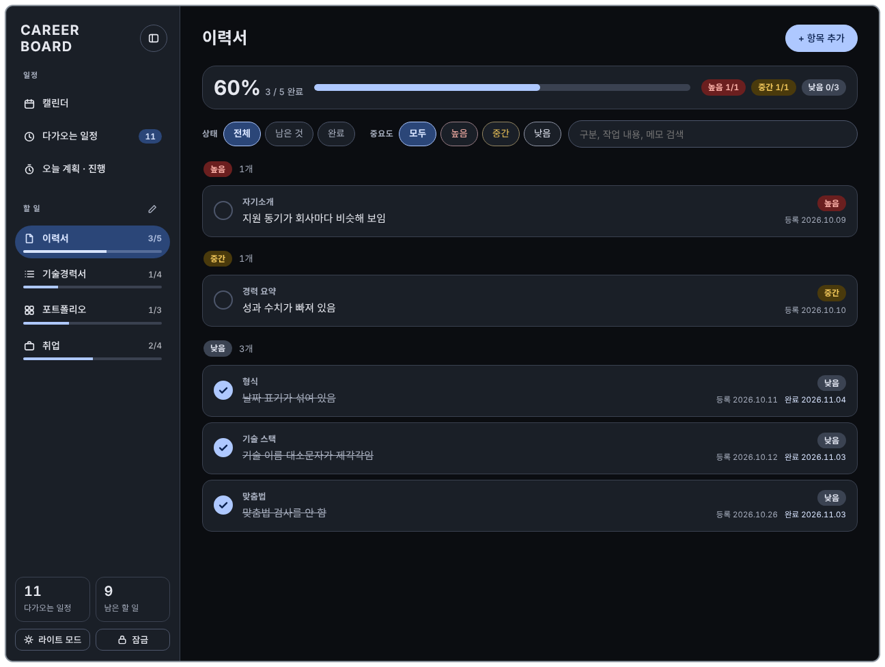
</p>
<p align="center"><sub>다크 모드</sub></p>

- 상단 카드에 탭별 진행률과 우선순위별 완료 수가 나옵니다. 상태·중요도로 거르고 검색할 수 있습니다.
- 항목은 높음 · 중간 · 낮음 순으로 묶입니다. 포기한 항목은 아래 접이식 "포기함"으로 가고 진행률에서 빠집니다.

### 오늘 계획 · 진행

<p align="center">
  
</p>
<p align="center"><sub>라이트 모드</sub></p>

<p align="center">
  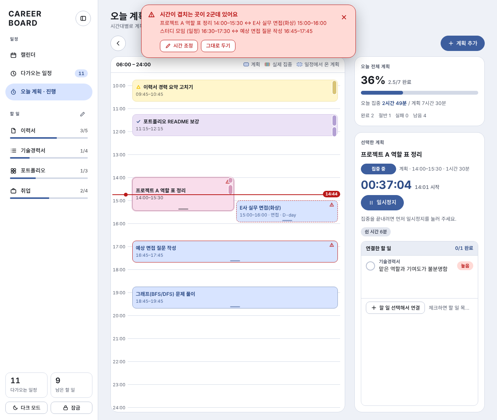
  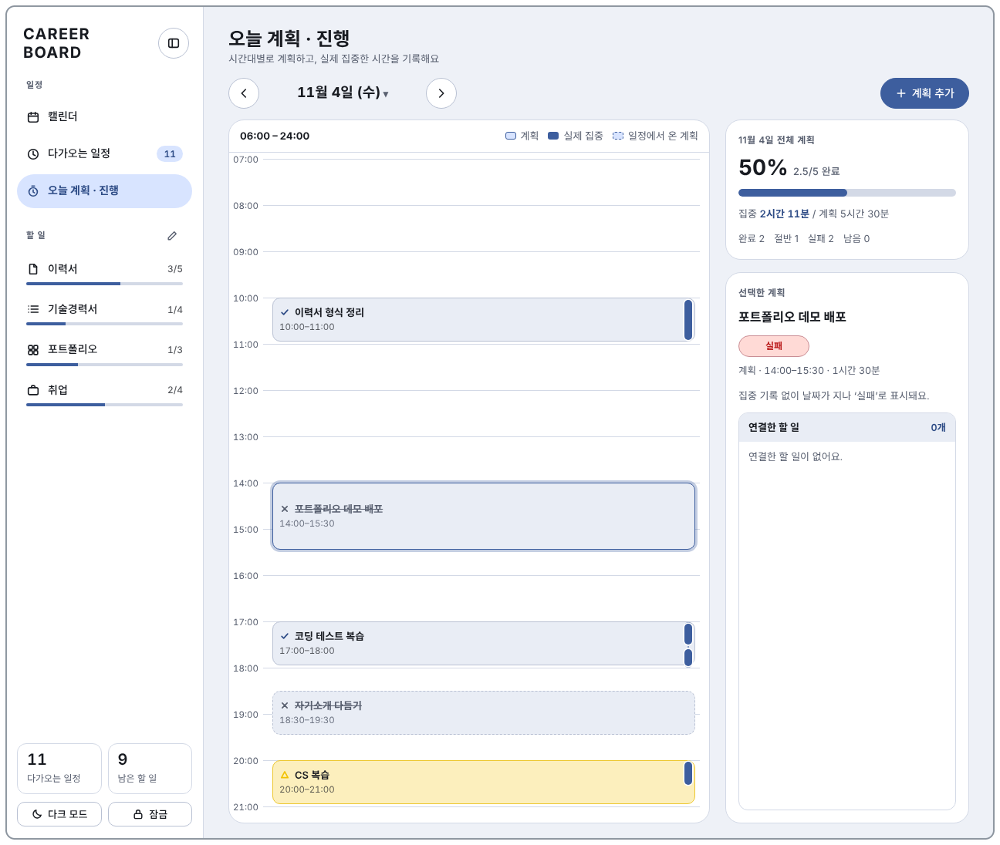
</p>
<p align="center"><sub>시간 겹침 경고 팝업 · 어제 (실패·절반 표시)</sub></p>

<p align="center">
  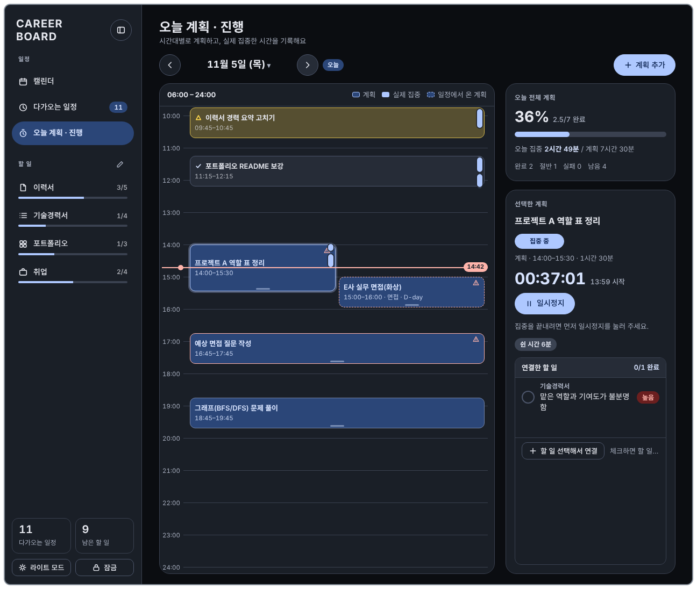
  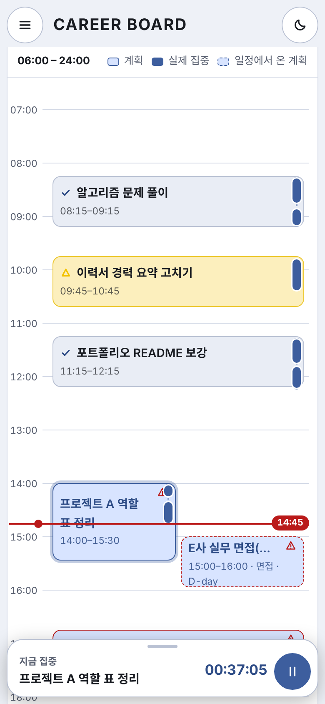
  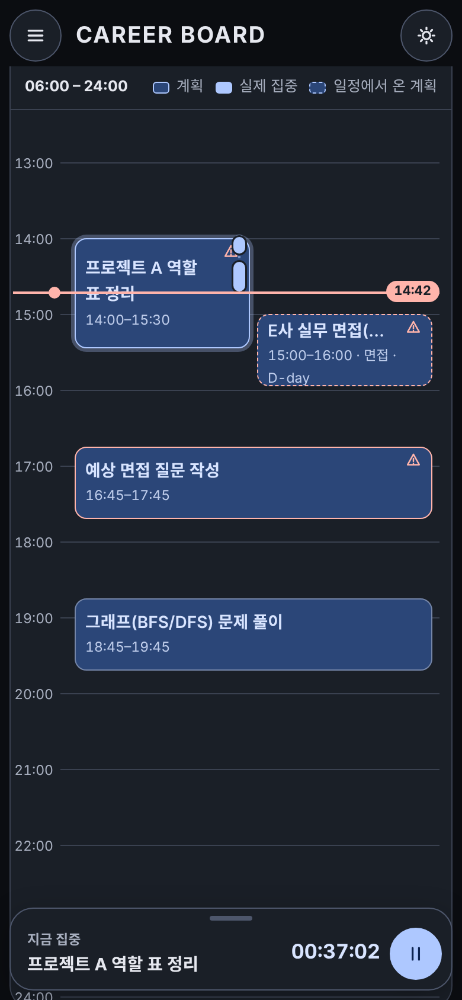
</p>
<p align="center"><sub>다크 모드 · 모바일 · 모바일 다크</sub></p>

- 시간표에서 계획은 상태별로 모양이 다릅니다. 완료 ✓, 절반 △, 실패 ✕, 대기와 집중 중은 아이콘 없이 표시하고, 점선은 일정에서 온 계획입니다.
- 계획 칸 오른쪽의 세로 막대가 실제 집중 구간입니다. 쉰 구간에서 끊어집니다.
- 시간이 겹치는 계획(원본 일정 포함)은 화면 위쪽에 뜨는 경고 팝업과 칸의 경고 아이콘으로 알려 줍니다. **시간 조정**으로 고치거나 **그대로 두기**를 고릅니다. 같은 겹침은 한 번만 띄웁니다.
- 계획의 이름·시간 수정과 삭제는 계획을 더블클릭(모바일은 선택 시트의 **수정**)해서 여는 팝업에서 합니다. 삭제는 한 번 더 확인하고, 일정에서 온 계획은 삭제 대신 시간표에서 뺍니다.
- 오른쪽 카드에서 오늘 전체 달성도(완료 1점, 절반 0.5점)와 선택한 계획의 타이머, 쉰 시간, 연결한 할 일을 봅니다.

### 메모 서식

일정 메모, 작업 내용, 자세한 메모, 진행 메모에서 마크다운 방식의 간단한 서식을 쓸 수 있습니다. 저장되는 것은 서식 기호가 들어 있는 일반 글자이고, 보여 줄 때만 꾸밉니다. 예전에 적어 둔 메모도 그대로 보입니다.

| 서식 | 입력 |
| --- | --- |
| 굵게 · 기울임 · 취소선 · 강조 | `**굵게**` · `*기울임*` · `~~취소선~~` · `==강조==` |
| 코드 | `` `코드` `` |
| 링크 | `[글자](https://주소)` 또는 주소를 그대로 입력 |
| 목록 · 번호 · 체크 | `- 항목` · `1. 항목` · `- [ ] 할 일` / `- [x] 끝낸 일` |
| 인용 · 제목 · 구분선 | `> 인용` · `# 제목` (`#`~`###`) · `---` |

- 목록 들여쓰기는 3단계까지 반영합니다. 표, 이미지, 여러 줄 코드 블록은 지원하지 않습니다.
- 글자는 HTML로 해석하지 않고, 링크는 `http`/`https` 주소만 열립니다.

## 실행 방법

설치할 것이 없습니다. 저장소를 받아서 `index.html`을 브라우저로 열면 됩니다.

```bash
git clone https://github.com/min-0o0/Career-Board.git
cd Career-Board
# index.html을 브라우저로 열거나, 간단한 서버를 띄워서 확인합니다.
python3 -m http.server 8000   # http://localhost:8000
```

처음 열면 가상의 샘플 일정, 할 일, 오늘 계획이 들어 있습니다. 입력한 데이터는 사용 중인 브라우저의 localStorage에만 저장되고 서버로 전송되지 않습니다.
(브라우저 데이터를 지우면 함께 사라집니다.)

## 구조

```
.
├── index.html       # 화면 구조(마크업)
├── style.css        # 스타일, 라이트/다크 테마 변수
├── app.js           # 화면 로직 (캘린더, 할 일, 오늘 계획·진행, 서식 메모, 잠금, 일정 종류/탭 편집)
├── local-db.js      # localStorage 기반 저장소 어댑터 + 샘플 데이터
├── docs/screenshots # README 이미지
└── docs/db          # DB 설계 문서 (명세서 PPT·생성 스크립트, ERD, 참고용 SQL)
```

## DB 설계 문서

- 명세서: [docs/db/career-board-db-spec.pptx](docs/db/career-board-db-spec.pptx) — 컬렉션·컬럼·관계·역할, ERD, 수정 내역
- 참고용 SQL: [schema.sql](docs/db/schema.sql) (SQLite 문법 DDL), [sample-data.sql](docs/db/sample-data.sql) (가상 샘플). 실제 앱은 SQL을 쓰지 않고 localStorage(JSON)에 저장하며, 같은 구조를 관계형으로 옮긴 설계 문서입니다.
- 명세서 생성 스크립트: [build.js](docs/db/build.js) (`cd docs/db && node build.js`)
- ERD: 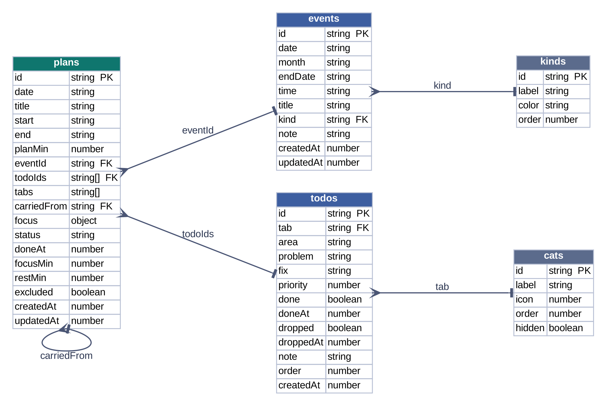
- 컬렉션 구조를 바꾸면 명세서의 수정 내역 페이지에 한 줄 추가합니다.

## 기술적으로 고민한 점

- **저장소 어댑터 분리**: 이 앱은 원래 Claude 아티팩트의 저장소(`window.claude.use("db")`) 위에서 동작하도록 만들었습니다.
  `local-db.js`가 같은 인터페이스(`collection().add / onSnapshot`, `doc().set / update / delete`)를 localStorage로 구현해서, `app.js`를 거의 고치지 않고 정적 호스팅에서도 같은 코드가 돌아갑니다.
- **날짜 미정 일정**: 일정 데이터에 `date`와 `month`를 따로 두어, 날짜가 확정된 일정과 월만 정해진 일정을 한 목록에서 정렬하고 표시합니다.
- **계산으로 구하는 상태**: 계획의 "실패"와 겹침은 저장하지 않고 화면에서 계산합니다. 집중 시간도 저장된 시작·종료·쉰 구간에서 매번 계산하므로, 기록을 고치면 막대와 통계가 함께 바뀝니다.
- **반응형 한 벌의 코드**: 데스크톱과 모바일의 내비게이션 구조가 다르지만 CSS 변수와 같은 컴포넌트를 공유해서 화면별로 코드를 나누지 않았습니다.
- **접근성**: 키보드 포커스 표시, `aria-label`, 순서 변경 시 키보드 조작을 지원하도록 마크업했습니다.
- **서식 메모를 안전하게 그리기**: 저장은 서식 기호가 든 일반 글자 그대로 두고, 보여 줄 때 정규식으로 해석해 DOM을 직접 만듭니다(`innerHTML`로 넣지 않으므로 메모에 HTML을 적어도 실행되지 않습니다). 링크는 `http`/`https`만 허용하고 `rel="noopener noreferrer"`를 붙입니다.

## 알려진 한계

- 화면 잠금은 같은 브라우저 안에서 화면을 가리는 용도입니다. 데이터를 암호화하지는 않으므로 민감한 정보는 입력하지 마세요.
- 데이터가 브라우저 localStorage에 있어서 기기 간 동기화는 되지 않습니다.
- 공휴일은 코드에 내장된 2025~2028년 목록을 사용하므로, 그 이후 연도는 직접 추가해야 합니다.
- 일정에는 종료 시각이 없어서, 일정에서 만든 계획과 일정의 겹침 계산은 길이를 60분으로 가정합니다.
- 지난 날짜의 계획은 보기만 할 수 있습니다. 집중은 그날(또는 자정을 넘는 계획의 다음 날)에만 시작할 수 있고, 절반 계획의 이어서 집중도 같은 날에만 가능합니다.
- 모바일에서는 계획의 길이를 끌어 바꿀 수 없습니다(시작 시간 이동과 수정 팝업은 가능). 자정을 넘는 계획은 끌어 옮길 수 없고 수정 팝업으로 고칩니다.
- 메모 길이는 일정 메모 500자, 작업 내용 600자, 자세한 메모 1200자, 진행 메모 2000자까지입니다. 서식은 한 줄 단위로 해석하므로 여러 줄에 걸친 굵게·코드 같은 표기는 적용되지 않습니다.
- "집중 중" 표시줄의 위치와 접힘 상태는 사용 중인 브라우저(localStorage)에만 저장되어 기기마다 따로입니다.

- 처음 열 때 한 번만 가상의 샘플 데이터가 들어가고, 이미 열어 본 브라우저에는 다시 들어가지 않습니다. 새 샘플을 보려면 브라우저의 사이트 데이터를 지우세요.
- 오늘 화면의 샘플은 열어 본 시각 주변(12:00~19:00 사이)에 맞춰 배치됩니다. "실패" 상태는 지난 날짜에서만 계산되므로, 오늘이 아니라 어제 화면에서 볼 수 있습니다.

## 라이선스

[MIT License](LICENSE)
